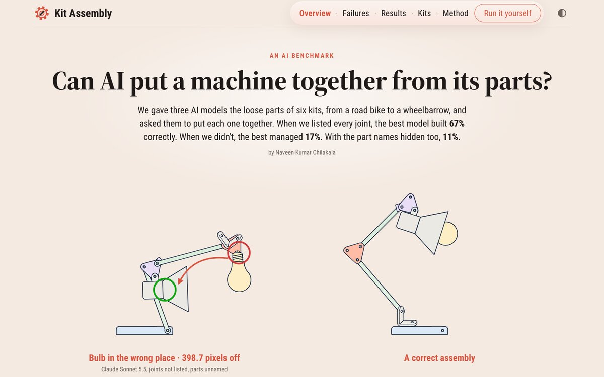
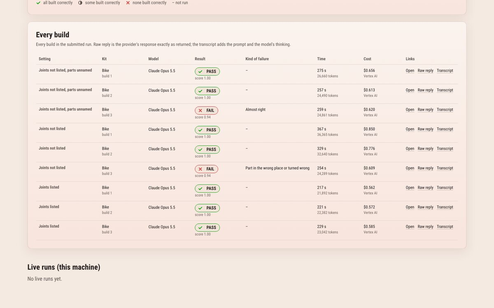
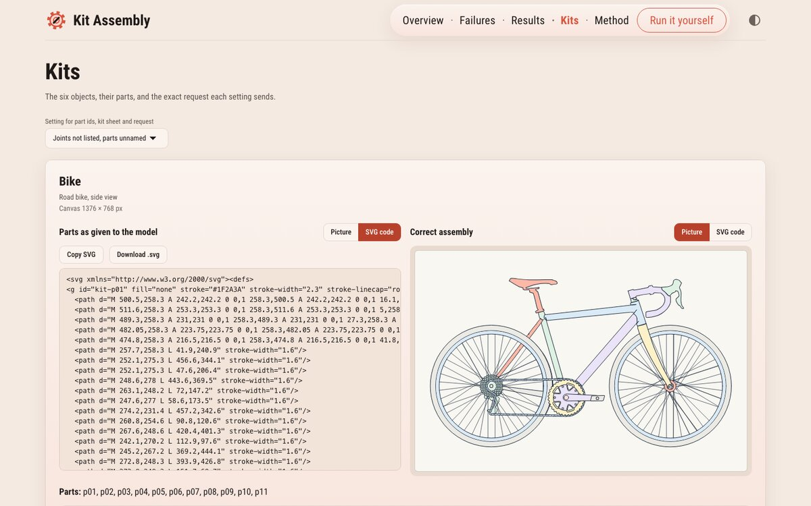
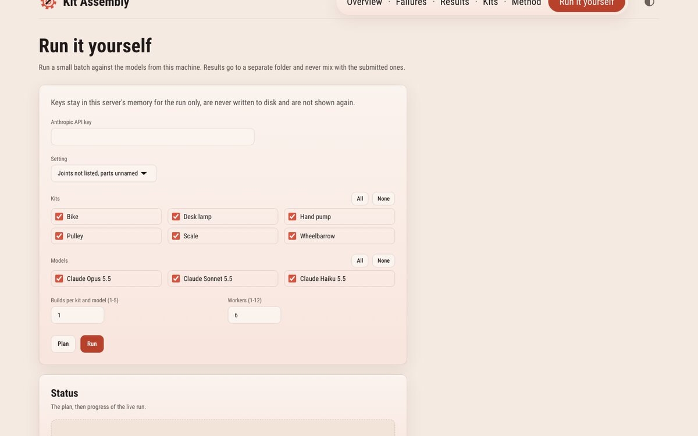

# Kit assembly: can AI build a working machine from a kit of parts?

By **Naveen Kumar Chilakala**: idea, benchmark design, kits, grading rules and review.

## 1. Short description
Many people build technical pictures (instruction manuals, repair guides, parts catalogues, product configurators, lesson diagrams, animations) by putting together parts that were drawn once. This benchmark asks whether AI can do that step: given the loose parts of a machine and only its name, can it put the machine together correctly, with every pin in the right hole and every part facing the right way?

**Key finding:** AI can follow assembly instructions, but it can't work out how a machine fits together. With every joint listed, the best model (Claude Opus 5.5) builds the machine correctly 72% of the time. Without the list it manages 33%, and with the part names hidden too, 28%. Its failed builds look almost right at a glance and are wrong at the joints.

Three Claude models, six machines, three tries each: 162 builds, every one checked by code (`results/summary.md`).

## 2. Video walkthrough
**Video:** https://www.loom.com/share/9a09cf47f3144ddab2c2754f1d2ba88e

The video covers the problem, how the test works, what the results show and why the models fail, using the results website.

## 3. Domain and expertise
**Domain:** technical illustration and mechanical assembly. Machines are drawn as reusable parts and must be put together so that they would really work.

**Expertise behind it:** Naveen Kumar Chilakala is an AI consultant and software engineer with more than eight years of building production software, and more than two years of designing, shipping and running AI agents that people rely on every day:
- **An AI agent platform used daily across a company:** built end to end, with tool-calling agents and several AI models working together.
- **Automated test-case generation with an AI agent in the loop:** the agent reads code changes and writes the tests, so far fewer tests are written by hand.
- **A central knowledge library connecting many code repositories:** one knowledge graph the agents query, so their answers come from the real code and not guesses.
- **A code-review agent:** it takes a pull request and returns a structured review.

Building these meant constantly checking whether an agent's output is actually right, not just plausible. This benchmark applies the same discipline to a visual task, drawing on three things:
- **Evaluation design:** fixed prompts, code-only grading, every reply and model thought stored and re-gradable.
- **Mechanical common sense:** which hole a pin goes through, which way a part faces, what can move and what must stay put. This is encoded as checks on visible features.
- **Illustration practice:** the bike and pulley come from Naveen's own illustration work, and the four new machines were made with Naveen's own drawing-to-vector pipeline (`kitmaking/`).

## 4. What it tests and why it matters
**The everyday problem.** Every day, people who write instruction manuals and repair guides, draw spare-parts catalogues, build product configurators for shopping sites, make lesson diagrams, or build game and animation assets put machines together from parts that were drawn once (a wheel, a crank, a hinge, a pulley). Putting the parts together is slow, fiddly work. It is exactly the job they want to hand to an AI: "here are the parts of a bike, put the bike together".

**The question.** If you give an AI the loose parts of a machine and only tell it what the machine is, can it put the machine together correctly? Nobody tells it which part goes where; it has to work that out, the way a person who knows the machine would.

**What "correct" means.** Not roughly right, and not "looks like a bike from across the room". Every wheel sits on its axle, every pin goes through the right hole, every part faces the right way. In short, the machine would actually work.

**Why the answer matters.** A wrong build is a wrong picture that looks almost right: a pedal on the wrong end of the crank, a pump handle pinned to the wrong hole. Most people won't spot it, so it teaches the wrong thing. If AI builds can't be trusted, someone has to check every joint by hand, which is the very work you wanted to save.

**How we tested it fairly.** Each machine is tried three ways:
- **Joints listed:** with a list of which part joins which. This checks the AI can follow instructions at all.
- **Joints not listed:** with only the part names.
- **Joints not listed, parts unnamed:** with the part names hidden, the way parts come out of a drawing tool.

If an AI builds the machine when told how, but fails when it has to figure it out, the problem isn't drawing or maths. The AI doesn't understand how the machine fits together.

### Who relies on this
These people put drawn parts together every working day, and this is the step they want to hand to AI:
- **Instruction-manual and repair-guide writers.** Furniture assembly sheets, appliance manuals and repair guides are built from part drawings, step by step. A pin in the wrong hole means a customer builds it wrong.
- **Technical illustrators.** Service manuals, spare-parts catalogues and patent drawings show the same parts assembled, exploded or swapped. Every picture has to be mechanically right.
- **Product configurators on shopping sites.** Pick a frame, wheels and handlebars, and the site must put the picture together correctly for every combination.
- **Engineering and science teachers, and e-learning teams.** Diagrams of pumps, levers, pulleys and engines are rebuilt for every lesson. A wrong joint teaches students the wrong thing.
- **Game and animation artists with modular kits.** Machines, vehicles and props are assembled from reusable pieces, and they must connect correctly or they fall apart when they move.

For all of them, a wrong assembly is worse than none: it looks right at a glance, so it gets published. If AI assemblies can't be trusted, someone still has to check every joint by hand, which is the work they wanted to save.

### What it tests (technical)
Given a kit of reusable SVG parts (each drawn in its own coordinate system, stored at an arbitrary rotation) and only the name of the object, can a model assemble a working object, with every real connection made at the right holes and every part facing the right way?

The same kits are run at three levels of help, hardest first:

| Level | Condition | The model gets |
|---|---|---|
| Hardest | **B**: unnamed parts, no recipe | parts labelled p01..pNN and "assemble a working X" |
| Middle | **A**: named parts, no recipe | parts named by role and "assemble a working X" |
| Easiest (control) | **C**: full recipe | every connection spelled out |

Every model gets the same prompt bytes for the same kit and level. The templates are in `kitbench/templates.py`. (The code also has an **A_alt** wording check, which was not part of this run.)

## 5. Setup and run instructions
Everything below runs on your own computer. You need Python 3.11 or newer, plus `rsvg-convert` (librsvg) for the pictures: `brew install librsvg` on macOS, `apt install librsvg2-bin` on Linux.

#### 1. Set up (one time)
```
cd kit-assembly-eval
pip install -r requirements.txt
```

#### 2. Check the results without any API key
None of these call a model, and each runs in seconds:
```
python run_eval.py --oracle              # the correct answers go through the grader: every kit must pass
python -m pytest -q tests                # grader and website tests
python scripts/regrade.py                # re-grade every saved model reply: grades must not change
python scripts/summarize.py --check      # confirm results/summary.md matches the saved results
```

#### 3. Look at the results in the website
```
python dashboard.py
```
Then open http://127.0.0.1:8000 in your browser. The site runs on your machine only.

| Page | What it shows |
|---|---|
| **Overview** | The question, how the test works, the results and the most common mistakes |
| **Failures** | Every failed build, with red where the model put a part and green where it belongs |
| **Results** | Tables per setting, and **Every build**: one row per build, linking to the build, the raw reply and the transcript |
| **Kits** | Each kit's parts as given to the model and the correct assembly, as pictures or SVG code you can copy |
| **Method** | Exact prompts, settings and grading rules |
| **Run it yourself** | Run models from the browser (step 4) |





#### 4. Run the models yourself
**Option A, from the website.** Open **Run it yourself** and follow these steps:
1. Paste your API key. It stays in the server's memory and is never written to disk.
2. Pick a setting, the kits and the models.
3. Press **Plan** to see the cost, then **Run**.

Your builds appear under **Results → Live runs**, kept apart from the submitted results.



**Option B, from the terminal.** The submitted run used Claude through Google Vertex AI:
1. Copy `.env.example` to `.env`.
2. Set `CLAUDE_ROUTE=vertex` and `GOOGLE_CLOUD_PROJECT`.
3. Sign in once with `gcloud auth application-default login`.

To use the Claude API instead, leave `CLAUDE_ROUTE` unset and put an `ANTHROPIC_API_KEY` in `.env`.
```
python run_eval.py --condition A --kits all --models all --trials 3 --dry-run   # plan and cost estimate
python run_eval.py --condition A --kits all --models all --trials 3             # then B and C
python scripts/summarize.py                                                   # rebuild the summary tables
python scripts/write_transcripts.py                                           # rebuild the readable transcripts
```
`--models all` means the three Claude models. A build already saved with the same prompt is skipped, so an interrupted run picks up where it stopped.

#### 5. Where everything is
| Folder or file | What is in it |
|---|---|
| `tasks/<kit>/task.py` | One kit: its parts, the joints the grader checks and the correct pose |
| `tasks/<kit>/build/` | What the model is given (`kit.svg`), the correct answer (`reference_solution.svg`, `reference.png`) and a parts sheet with attach points (`kit_marked.png`) |
| `kitbench/templates.py` | The prompt templates for the three settings |
| `kitbench/grader.py`, `kitbench/kit.py` | The grader and the checks it runs |
| `run_eval.py`, `kitbench/models.py` | The harness and the exact model settings |
| `results/<setting>/<kit>/<model>__t<k>.json` | One graded build: prompt fingerprint, settings, the reply, tokens, time and every check with its error |
| `results_raw/...` (same names) | The provider's response for that build, as returned, with the model's thinking |
| `transcripts/...` (same names, `.md`) | A readable transcript: prompt, thinking, answer and grade |
| `results/summary.md` | Every table in this README, generated from the results |
| `review/` | Close-ups of every graded joint, and the AI and manual review notes |
| `kitmaking/` | How the four new kits were made, from drawing to graded task |
| `scripts/` | Regrade, summary, transcripts, package check, ZIP |
| `dashboard.py`, `web/` | The results website |
| `RULES.md`, `STORY.md` | The 29 rules the benchmark was built and checked against, and the short story behind it |

Settings appear under these short codes in the files: **B** = joints not listed, parts unnamed; **A** = joints not listed; **C** = joints listed.

#### Approximate runtime and cost
- **Cost:** model calls for the 162 builds cost about $64.52 at list prices, from the stored token counts (per condition and model in `results/summary.md`). That is about $0.70 a build for Opus, $0.45 for Sonnet and $0.05 for Haiku.
- **Time per build:** median 326 s, longest 1,068 s.
- **Wall-clock:** with every build sent at once, the full run takes about 20 minutes.
- **No-key commands:** grading, the reference check and the tests need no API key and run in seconds.

## 6. Models tested and results
Run on **2026-11-08**.
- **Models (exact IDs):** `claude-opus-5-5`, `claude-sonnet-5-5`, `claude-haiku-5-5`.
- **Runs per task:** 3 tries for every model, kit and condition.
- **Temperature:** not set, so the provider default applies. Thinking: adaptive, effort high.
- **Builds:** 6 kits x 3 conditions x 3 tries = 54 builds per model, 162 in all, with no API errors.
- **Settings:** every call went through Google Vertex AI with the same settings: max 128,000 output tokens (each model's maximum), adaptive thinking (summarized), effort high, streamed, one fresh single-turn request per build.

Builds assembled fully correctly (every check passed):

| Model | Joints not listed, parts unnamed (B) | Joints not listed (A) | Joints listed (C) |
|---|---|---|---|
| Claude Opus 5.5 | 5/18 (28%) | 6/18 (33%) | 13/18 (72%) |
| Claude Sonnet 5.5 | 3/18 (17%) | 3/18 (17%) | 5/18 (28%) |
| Claude Haiku 5.5 | 0/18 (0%) | 1/18 (6%) | 3/18 (17%) |

What stands out per kit:
- **Desk lamp:** never built correctly in 54 builds. Even with every joint listed, Opus leaves the bulb just outside its socket.
- **Hand pump and balance scale:** built correctly only with the joints listed, and only by Opus (2 of 3 each). Without the list, 0 of 36 each.
- **Wheelbarrow:** with the joints listed, Opus builds it every time. Without the list, one correct build in 36.
- **Pulley:** the easiest kit. Opus and Sonnet build it every time in every condition.
- **Bike:** Opus builds it 2 times in 3 without the list, and every time with it.

Full tables (per kit, mean score, tokens, time, cost) are in `results/summary.md`, generated by `scripts/summarize.py` and checked against the saved results with `--check`. The desk lamp's nine joints-listed builds were made with an earlier wording of its joint list, which named one specific hole on each plate. They are graded with the final rule, where any of a plate's holes counts, so a model following either wording passes.

## 7. Failure analysis
Every failed build, by its main problem (all conditions and models, 123 failed builds):

| What went wrong | Builds |
|---|---|
| Part in the wrong place or turned wrong | 101 |
| Almost right (every miss small, at least one just outside the margin) | 11 |
| Hit the length limit before answering (all Haiku) | 10 |
| Answer could not be read | 1 |

Most failures are not near misses. The most common failed checks are off by 64 to 475 px (median):
- the lamp's bulb not in its socket, and its bracket stood on its side;
- the pump's link bar not reaching the cap's lug;
- the scale's beam not on its pillar, and its pans not in their cradles;
- the bike's pedal and saddle in the wrong place;
- the wheelbarrow's leg not under its frame.

The models place each part roughly where it belongs, but they don't line up the actual holes and edges. The result looks almost right at a glance and is wrong at the joints. That is the failure that makes AI assembly untrustworthy for anyone publishing technical pictures. Every build has a transcript with the model's thinking in `transcripts/`.

## 8. Prior work and sources
Closest work, and how this benchmark differs (arXiv ids):
- **TangramPuzzle** (2601.16520): rigid pieces with exactly specified shapes, code-checked; success 0-22%. Here the parts are real illustration artwork, and nothing about how they join is given in conditions A and B.
- **OmniCAD** (2608.22637): parts plus a mate graph go in, and the model gives a pose for every part. That is close to this benchmark's condition C; conditions A and B remove the mate graph.
- **MUSE** (2605.28579): one-shot multi-part CAD code graded for overlap, connectivity and clearance. Here the model places existing drawn parts instead of writing geometry.
- **SCBench** (2604.09594): code-verified constructive puzzles (packing, Lego shells) that degrade with part count. Here the parts are different objects with functional joints, not repeated blocks.
- **Autoregressive Mosaics** (2608.30751): when absolute coordinates are given, small models place parts almost perfectly. This benchmark never gives coordinates, which is the point.
- **PlanarBench** (2606.02010): building a layout from relations; the score falls as the number of constraints grows. Here the relations themselves must be inferred from the drawings.
- **GeoSVG-RL** (2605.25447): an SVG grader that resolves nested transforms. This grader does the same, then checks joints at visible features and each part's orientation.
- **MoVer** (2502.13372, SIGGRAPH 2025): verifying SVG motion graphics against a written spec. Here there is no spec of positions, only the object's name.

### Sources and provenance
- **Before the hackathon:**
  - The bike and pulley drawings, from Naveen Kumar Chilakala's illustration work.
  - Naveen Kumar Chilakala's vectorizer, which turns a picture into an editable SVG.
- **Built during the hackathon:**
  - The four new kits (`kitmaking/`).
  - The grader, harness and prompts.
  - The results site (`dashboard.py`, `web/`).
  - Every result in `results/`.
- **Raw records:**
  - Every model reply is stored as the provider returned it, in `results_raw/`.
  - The graded record is in `results/`, and a readable transcript with the model's thinking is in `transcripts/`.

---

## More detail

## Tasks
Six kits, 6 to 11 parts each, all in one flat line-art style: thin navy outlines and pale flat fills.

- **Bike and pulley:** the artwork is Naveen Kumar Chilakala's own earlier illustration work.
- **Hand pump, desk lamp, balance scale and wheelbarrow:** made for this eval with Naveen Kumar Chilakala's pipeline (see `kitmaking/README.md`):
  1. An image model drew each part alone, then the machine built from those parts.
  2. Each part was vectorized with Naveen Kumar Chilakala's own vectorizer.
  3. The parts were combined at their own holes, hooks and edges.

| Kit | Parts | What makes it hard |
|---|---|---|
| bike | 11 | Drivetrain chain of dependencies (chainring, crank, pedal); seat and headset contacts; two near-identical wheels. |
| pulley | 9 | Rope wrapped concentrically round two wheels; a hanging chain of hook, shackle and box. |
| hand_pump | 7 | Handle, link bar and piston rod pinned in a loop; the cap's lug holes must meet the link. |
| desk_lamp | 8 | Two near-identical arms pinned through two three-hole plates; only one combination closes the linkage. |
| scale | 8 | Beam on the pillar pivot; stirrups hooked through the beam-end eyes; pans seated in the stirrup cradles. |
| wheelbarrow | 6 | Tray and leg bolted to the handle frame's tabs; the fork carries the wheel hub and the tyre. |

Correct assemblies: `tasks/<kit>/build/reference.png`. What a model is given: `tasks/<kit>/build/kit.svg`.

## How the prompts were written
- **One fixed template per condition** (`kitbench/templates.py`). Per kit only the slots change: part count, object name, canvas size, base part, tolerances and the kit SVG. Every model receives the same prompt bytes for the same kit and condition; each result stores the prompt's SHA-256 so this can be checked.
- **What every prompt says:**
  - the kit is a set of SVG parts, each in its own coordinate system and stored at an arbitrary rotation;
  - assemble a complete, working object on a fixed canvas;
  - parts are rigid: translate and rotate only, no scaling or mirroring;
  - use every part exactly once;
  - the base part stays upright;
  - reply with one SVG of `<use>` elements, one per part.
- **What the conditions change:**
  - A and B explain how the build is graded but give no positions, no angles and no list of which part joins which; B also hides the part names (ids p01, p02, ...).
  - C lists every connection in plain words, still without positions or angles.
- **One fresh request per build:** single turn, no examples and no retries on a wrong answer.

## Benchmark rules
The rules the benchmark was built and checked against are in `RULES.md` (R1-R29), checked file by file before submission. Highlights:
- identical prompts across models;
- no recipe in conditions A and B;
- anchors only on features both parts visibly show;
- reference solutions must pass every check;
- every number comes from `scripts/summarize.py`;
- re-grading the saved replies with no API key reproduces the summary;
- no secrets or machine details in the package.

## Grading
Code only, no model judge. The grader reads where each part lands (composing every transform) and checks:
- **connections**: the matching visible features of two connected parts (hole centres, hub centres, centres of rounded ends, seats) coincide within the kit's tolerance;
- **orientation**: every part faces the way it does on the working object, relative to the base part, within 8 degrees;
- **real freedoms are allowed**, so no correct build is marked wrong:
  - wheels and other parts that turn in use may sit at any angle;
  - jointed mechanisms may take any pose their pins allow (the desk lamp's arm, the pump's handle stroke);
  - a part that could sit anywhere along an edge or centre line may do so (the lamp's and pulley's brackets, the pump's piston rod in its bore);
  - the scale's stirrups may hang by their hook or be pinned through the hole in their rod;
  - identical parts may swap (the bike's wheels, the scale's pans and stirrups);
- **physical rules**: anything on the ground stands level;
- **integrity**: a missing, duplicated, scaled, skewed or mirrored part fails the assembly.

A trial passes only if every check passes. The score is the fraction of checks passed.

### How the grader was validated
- **Reference solutions pass.** Every kit's correct assembly passes every check in every condition (`python run_eval.py --oracle`).
- **Tests, no API keys needed** (`python -m pytest -q tests`):
  - Every kind of wrong assembly fails the grade: a part moved, turned, mirrored, scaled, skewed, missing or doubled.
  - Every real freedom above passes: a lamp re-posed at the elbow, a bracket slid along its edge, a stirrup hung either way, swapped identical parts.
  - Malformed replies are read safely.
- **Bugs found and fixed before the final run.** The run was restarted from scratch after each fix, and the superseded runs are kept out of the results:
  - Orientation was not graded in the unlisted-joint settings.
  - One anchor sat on a hidden point.
  - Identical wheels were not allowed to swap.
  - Model ladders compared unequal numbers of trials.
  - The first output cap (64,000 tokens) cut off long reasoning; the final run uses each model's maximum, 128,000.
  - The first versions of the four new kits had very dense outlines (450,000-765,000 prompt tokens); they were simplified to 16,000-25,000 tokens with the same shapes.
  - A grading review found checks that could fail a working build: a hidden piston point, fixed bracket positions, fixed lamp and pump poses, and one stirrup attachment. Each was fixed and the affected builds were run again.
- **Reviewed twice, by AI and by hand.**
  - Independent AI reviewers inspected every part and joint of every correct assembly (angle, placement, which part sits in front, holes lining up) and flagged anything that looked wrong.
  - Naveen Kumar Chilakala then reviewed every assembly and every graded joint by hand, and fixed what was wrong before the final run. Examples: the pulley's hook turned 90 degrees so the shackle hangs through it, and the balance scale's pointer hung from the beam's pivot.
  - Close-ups of every graded joint are in `review/joints/`, and the review notes are in `review/zoom_review.md`.
  - Passing and failing replies were also checked by rendering them, not only by trusting the grader.

## Transcripts
Every build has three records, under the same `<condition>/<kit>/<model>__t<k>` name:
- **`results/`:** the graded record: prompt fingerprint, settings, reply, tokens, time, every check with its error.
- **`results_raw/`:** the provider's response message as returned, including the model's thinking blocks.
- **`transcripts/`:** a readable Markdown transcript with the prompt, the model's thinking, its answer and the grade.

The results site (`python dashboard.py`) links all three for every build in its Results table.

## Hot take
AI can follow assembly instructions, but it can't yet work out how a machine fits together. With the joints listed, the best model builds 72% of the machines correctly. Take the list away and it falls to a third. Its builds look right at a glance and are wrong at the joints, which is the most dangerous kind of wrong for anyone making manuals, catalogues or lesson diagrams.

## AI use
The idea, the benchmark design, the choice of machines, the grading rules and every review decision are mine. I used AI in four ways:

1. **Coding assistant:** to help write and test the harness, the grader, the results site and the scripts. I directed the work and checked the output.
2. **Image model:** to draw the parts of the four new machines (hand pump, desk lamp, balance scale, wheelbarrow), one part at a time, in the same style as my bike drawing. I then vectorized them with my own vectorizer.
3. **AI reviewers:** to inspect every joint of every correct assembly and audit the package. I reviewed their findings and every assembly by hand before the final run.
4. **The models under test:** Claude Opus 5.5, Sonnet 5.5 and Haiku 5.5. They are only what is being measured.
